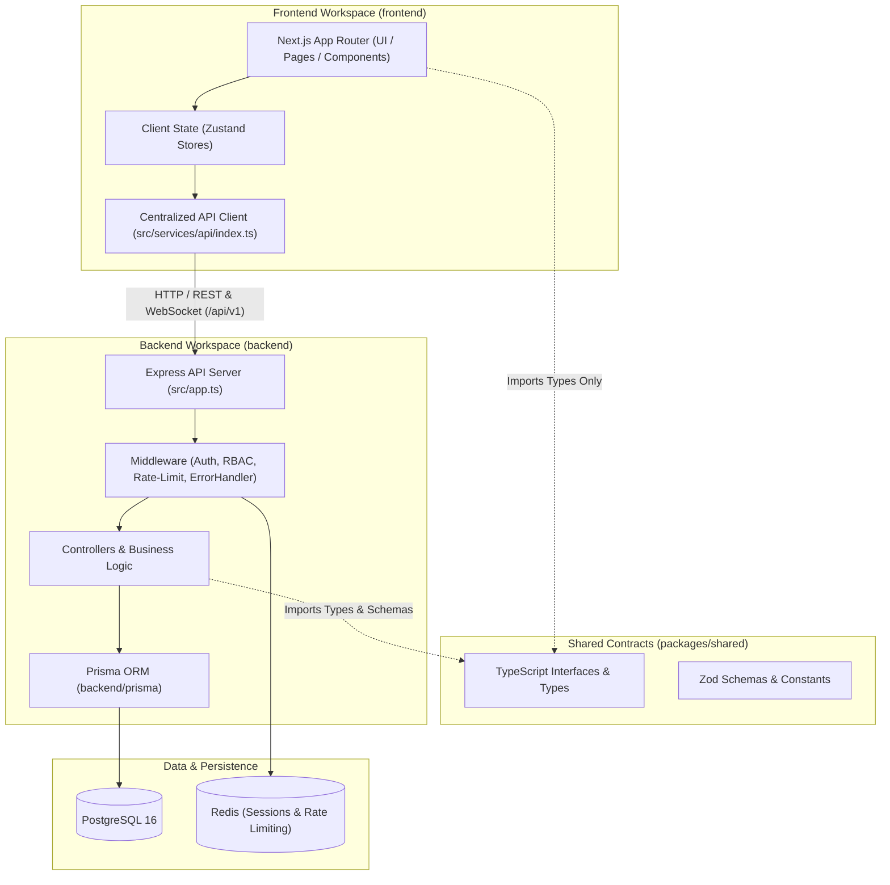
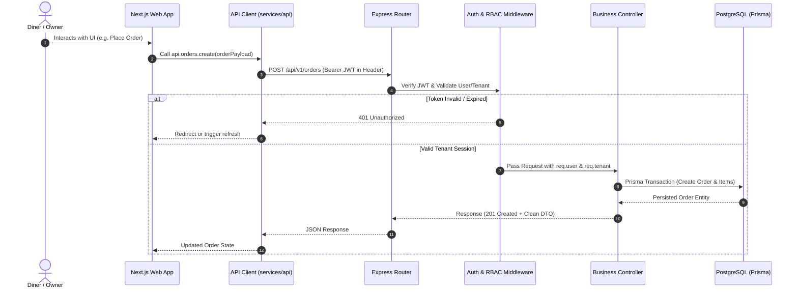
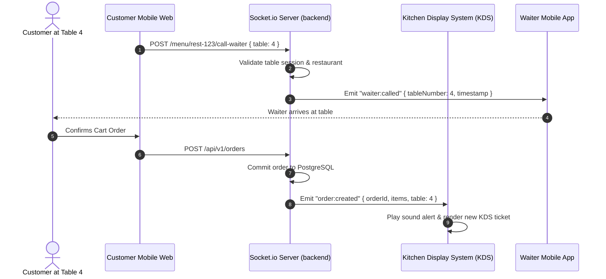

# Architecture Overview

This document details the architectural boundaries, dependency flows, and separation of concerns in the QR Restaurant Monorepo.

---

## 1. Monorepo Structural Boundaries

The repository is organized into strictly isolated workspaces orchestrated via Turborepo:

---

## 2. Hard Isolation Rules

1. **Strict No-Cross-Imports**:
   - `frontend/` MUST NEVER import from `backend/`
   - `backend/` MUST NEVER import from `frontend/`
   - Enforced by ESLint rule `no-restricted-imports` and TypeScript path resolution.
2. **Centralized Communication Gate**:
   - The frontend communicates with the backend exclusively through HTTP REST calls and WebSocket events originating from `frontend/src/services/api/index.ts`.
3. **Shared Contracts**:
   - Data transfer object (DTO) interfaces, role enums, and order status definitions reside in `packages/shared`.
   - `packages/shared` compiles before frontend and backend via Turbo pipeline dependency (`^build`).
4. **Database Encapsulation**:
   - The Prisma Client and schema are private to `backend/`. The frontend never has direct access to the database or Prisma schemas.

---

## 3. Request Lifecycle & Authentication Flow

---

## 4. Real-time Kitchen & Waiter Architecture

---

## 5. Deployment Topology

- **Web Service (Frontend)**: Deployed as a containerized Next.js service or Static Web App via `docker/Dockerfile.frontend`.
- **API Service (Backend)**: Deployed as an Express container via `docker/Dockerfile.backend` with horizontal scaling capability.
- **Database**: Managed PostgreSQL instance with SSL connections enforced (`sslmode=require`).
- **Cache**: Managed Redis cluster for rate limiting and socket session synchronization.
